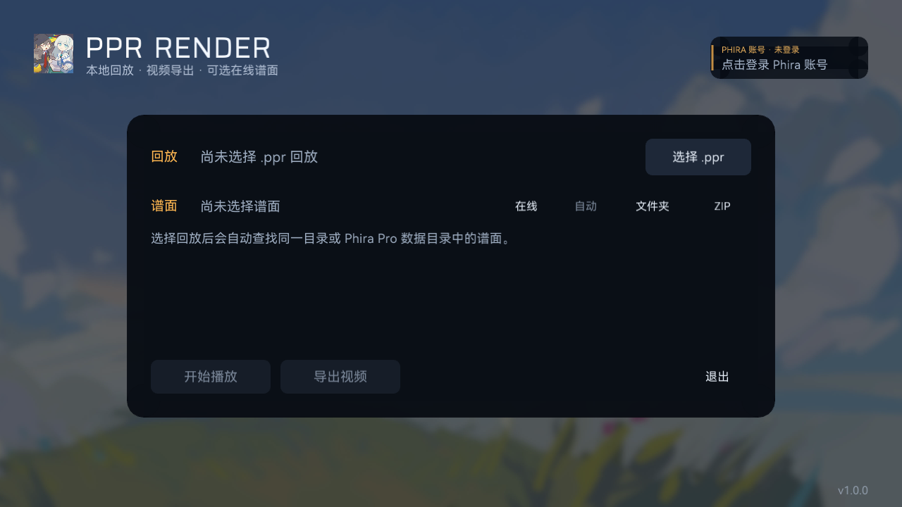

# PPR Render

**PPR Render** 是一个独立的 `.ppr` 回放播放器与视频导出器，提供桌面与 Android 图形界面。它读取 Phira Pro 录制的 `.ppr` 回放，按回放中的真实判定和触点播放，并把同一份回放渲染为 MP4 视频。当前版本为 **1.0.0**。

## 这是什么

PPR Render 不是音游本体，也不是谱面编辑器。只是一个渲染 [Phira Pro](https://github.com/Phira-Pro/Phira-Pro) 导出的 `.ppr` 文件。
它只做两件事：播放 Phira Pro 回放，以及把回放导出为视频。回放中的判定、连击、长条状态、触点和音符音效都来自录制文件，不使用自动演示替代。

## 基于什么

本项目基于 [Phira Pro](https://github.com/Phira-Pro/Phira-Pro) 的 `prpr` 渲染引擎，通过 Rust path 依赖复用其谱面动画、HUD、打击特效、演出时间轴和音频播放能力。项目不修改 Phira Pro 源码，不是 Phira Pro 官方客户端，也不代表 Phira Pro 团队发布。

Phira Pro、Phira 与 `prpr` 均以 GPL-3.0-only 授权；完整来源、资源署名和依赖许可见文末「许可与第三方说明」。

- **本地优先**：回放、谱面、音乐、曲绘默认全部从本地读取；网络只用于可选的 Phira 账号登录与在线谱面下载。
- **单文件分发**：桌面版把字体、默认资源包、HUD 贴图嵌入可执行文件，首次启动时释放到系统缓存目录；Android 版放在 APK 的 assets 中。谱面与音乐仍由用户提供。
- **跨平台**：Linux / Windows / macOS / Android 共用同一套渲染与播放逻辑。Android 版本打包了 arm64 FFmpeg，安装后即可离线导出视频。



## 功能

- 解析 `.ppr` v3–v6（v5 / v6 为 Zstandard + JSON），读取判定、触点、帧时间、录制设置和 Mod。
- 按回放事件恢复实时分数、连击、长条判定、打击特效与音效。
- 还原 RPE / PEC / PBC / Phigros 谱面的动画、判定线、RPE 判定区阻挡和长条音效。
- 触点插值与 F1/F2 编号显示，回放块区触摸检测；触点在噪域内时音乐同样会像 Phira Pro 一样切到低通，离开后平滑恢复。播放与导出音轨都会应用这一效果。
- 选择 `.ppr` 时自动查找同目录下同名的谱面压缩包（`.zip` / `.phira` / `.pez`，忽略大小写，也支持 `song.pez.zip`）；找到就自动填入，找不到保持静默。
- 进度拖动、倍速、BAD/MISS 快速定位。
- 图形界面选择回放 / 谱面、播放、导出；带进度预览和中途取消。
- 谱面目录或 ZIP 均可直接播放；也支持常见 Phira Pro 数据目录自动查找。
- 可选 Phira 在线谱面：在主界面输入谱面 ID 即可下载并载入；若只选了回放就点击「开始播放」或「导出视频」，会按回放中的谱面 ID 自动下载。可选择登录 Phira 账号，登录凭据只在本机保存刷新令牌。
- 离线导出 MP4：直接复用 Phira Pro 的谱面渲染流程，包括开场加载卡、演出背景、结算面板和音频时间轴；谱面阶段仍是这份回放的判定与触点，而不是自动播放演示。
- 导出不受实时帧率影响；音轨由音乐 + 回放打击音合成，可选分辨率、帧率、区间、HUD、触点、开场与结算，以及准确率、判定详情、AP/FC 指示等游玩画面选项。

## 构建

需要 Rust（版本由 `rust-toolchain.toml` 固定为与 Phira Pro 一致的 nightly；能编译 `prpr` 的较新 stable 也可以）、
Python 3.8+（构建脚本只使用标准库）和对应平台的 C/C++ 编译环境。

构建前请准备 Phira Pro 的 `prpr` 源码，并让 `Cargo.toml` 中的 `prpr` path 依赖指向它；不需要修改 Phira Pro 源码。

在项目根目录执行：

```bash
# 仅编译 release
python3 build.py

# 编译并生成分发包
python3 build.py --package

# 直接打包已有的 release 程序
python3 build.py --package --skip-build
```

Windows 使用 `python build.py`，Linux / macOS 可使用 `python3 build.py`。
生成的程序位于 `target/release/ppr-render`（Windows 为 `ppr-render.exe`）。

`build.py` 会执行 `cargo build --locked --release`，版本号从 `Cargo.toml` 读取，
平台名从 Rust 主机目标派生；设置 `CARGO_BUILD_TARGET` 时会使用对应的目标和输出目录。
`--platform windows|linux|macos` 可显式指定平台，但必须在对应系统上原生构建。
`--output` 可指定分发包输出目录（桌面 ZIP 或 Android APK），默认是项目下的 `dist/`。

各平台的编译环境：

| 平台 | 依赖 |
| --- | --- |
| Windows | Visual Studio C++ Build Tools / Windows SDK |
| Linux | GCC / Clang、pkg-config、ALSA、X11、Wayland、OpenGL、D-Bus、zlib |
| macOS | Xcode Command Line Tools |

Linux 可安装以下开发包（运行已编译程序时只需要运行库）：

```bash
sudo apt install --no-install-recommends build-essential cmake pkg-config \
  libasound2-dev libx11-dev libxi-dev libwayland-dev libgl1-mesa-dev \
  libdbus-1-dev zlib1g-dev
```

`rfd` 默认使用 XDG Desktop Portal。如果桌面环境没有 portal 服务，可以安装对应的 portal 后端；界面中的文件选择依赖它。

### Android

Android 版本需要 Android SDK、NDK **27.2.12479018**、JDK 17+、
Rust 的 `aarch64-linux-android` 目标、`cargo-ndk`，以及 `curl` 和 `make`
（首次构建会下载并编译 FFmpeg）。在项目根目录执行：

```bash
python3 build.py android
```

脚本会按 Phira Pro 的同一套参数交叉编译静态 x264 与 FFmpeg 7.1.1
（默认缓存在 `target/android-ffmpeg/`），再用 Gradle 构建 arm64 APK。
产物为：

```text
dist/ppr-render-v1.0.0-android-arm64-v8a.apk
```

`--force-ffmpeg` 可忽略缓存重新编译 FFmpeg，`--skip-ffmpeg` 用于复用已有
FFmpeg 产物，`--offline` 让 Cargo 与 Gradle 使用本地缓存。APK 默认使用
调试密钥签名，方便直接安装；正式分发请替换成自己的签名配置。GitHub Actions
中的 Android 工作流会从仓库 Secrets 注入正式签名，缺失时直接失败，不会回退到调试签名。

Android 端不需要系统安装 FFmpeg：APK 中的 `libffmpeg.so` 会随安装解压到
原生库目录，应用启动时复制到缓存目录并补上可执行位。Android 10 起禁止
`targetSdk >= 29` 的应用执行自身数据目录中的文件，因此本 APK 使用
`targetSdk 28`，这也是 Phira Pro 的做法。

### 版本固定

`rust-toolchain.toml` 固定了构建使用的 Rust nightly 版本，与 Phira Pro 保持一致。

`Cargo.toml` 固定了 Phira Pro 使用的 macroquad / miniquad git revision，避免上游分支变化导致回放视觉或输入行为漂移。升级 `prpr` 时，请同步更新本项目的 macroquad revision。

### 自动构建

仓库提供三套 GitHub Actions 工作流，均可在 Actions 页面手动触发：

- `Build Desktop Packages`：分别在 Windows、Linux、macOS 上构建并打包桌面版。
- `Build Android APK`：构建 arm64-v8a 的正式签名 APK，读取仓库 Secrets 中的 `ANDROID_KEYSTORE_BASE64`、`ANDROID_KEYSTORE_PASSWORD`、`ANDROID_KEY_ALIAS`、`ANDROID_KEY_PASSWORD`；缺少任一 Secret 时直接失败，不会回退到调试签名。
- `Publish Release Assets`：发布 Release 后自动构建桌面包和 APK 并上传到该 Release，也可手动指定 tag。tag 必须等于 `Cargo.toml` 中的版本号，或为该版本号加 `v` 前缀。

构建产物以 `ppr-render-<平台>-<架构>` 和 `ppr-render-android-ARM64` 的 artifact 形式提供。工作流通过 `.github/phira-pro-ref` 固定 `prpr` 依赖使用的 Phira Pro 提交，避免上游更新导致构建漂移；升级 Phira Pro 依赖时同步修改该文件中的提交 SHA。

## 运行

直接启动会进入图形界面；所有操作都能在界面里完成，不需要命令行参数：

```bash
ppr-render
```

界面中可以选择 `.ppr` 回放、谱面文件夹或谱面 ZIP，然后播放或导出视频。选择回放后会自动查找同目录及常见 Phira Pro 数据目录里的谱面。主界面会保留本次选择，退出播放后会回到这里。

### Android 使用

Android 版本要求 Android 8.0（API 26）或更高，仅提供 arm64 构建。
把 `.ppr` 回放和对应谱面（文件夹或 ZIP）放到手机的「下载」等共享目录，
然后在应用内点击「选择回放」浏览即可。Android 没有桌面系统文件对话框，
应用内提供了带「下载 / 文档 / 主目录 / 应用文件」快捷入口的文件浏览器；
回放和谱面放在同一目录时仍会自动匹配同名谱面。从共享目录读取文件需要
授予存储读取权限；如果系统限制了共享目录访问，可以用 `adb push` 把文件
放进应用外部文件目录（`Android/data/org.pprrender.app/files`），再从
「应用文件」进入。

在线谱面的账号与谱面 ID 输入使用系统输入框。导出完成后视频会出现在
系统「下载/ppr-Render」，文件管理器与相册都能直接打开；如果公共下载目录
不可写，会退回到应用外部目录的 `Movies/ppr-Render`，不会只留在缓存中。
播放本身不写入共享存储；部分旧系统首次启动会请求读写共享存储的权限。

谱面行右侧的「在线」可以按 Phira 谱面 ID 下载在线谱面，下载完成后会自动选中；ID 可以直接填数字，也可以带 `#` 或全角 `＃` 前缀。只选了回放、还没选谱面时，直接点击「开始播放」或「导出视频」也会尝试按回放中的谱面 ID 在线下载：如果回放指向的是本地谱面、而不是在线谱面，会提示手动选择；如果谱面已下架、服务器出错或本机没有网络，会分别显示对应的错误提示。登录 Phira 账号是可选操作：公开谱面不登录也能下载，登录后请求会携带账号令牌。登录只保存刷新令牌到系统数据目录（Linux 默认 `~/.local/share/ppr-render/account.json`），不会保存密码。主界面右上角显示当前账号状态，右下角显示版本号。

也可以带参数启动，用来自动预选文件：

```bash
# 打开图形界面并预选回放 / 谱面
ppr-render replay.ppr /path/to/chart

# 跳过主界面，直接播放
ppr-render --play replay.ppr /path/to/chart
```

回放和谱面可以放在同一个文件夹。程序会按回放文件名、谱面 ID 和常见 Phira Pro 资源位置自动查找；仍未找到时，可以在界面里手动选择文件夹或 ZIP。

### 导出视频

桌面端视频导出需要系统里有 **FFmpeg**（`ffmpeg` 命令或 `PHIRA_FFMPEG` 指向可执行文件）。Android 端已随 APK 打包 FFmpeg，无需额外安装。播放功能本身不依赖 FFmpeg。

桌面端默认把视频保存在回放文件旁边，可用环境变量 `PPR_RENDER_OUTPUT_DIR`
指定其他目录。Android 端先写入应用缓存：Android 10 及以上通过 MediaStore
发布到系统「下载/ppr-Render」，不需要存储写入权限；Android 9 及更早会直接
写入公共下载目录，首次启动时请求写入权限。

在图形界面中选择回放和谱面后点击「导出视频」，可以设置：

- 1080p / 720p / 540p 分辨率；
- 60 / 30 fps；
- 高画质 / 标准 / 小体积；
- 谱面时间区间；
- 输出路径；
- 是否绘制分数 HUD、回放触点、音轨；
- 是否渲染 Phira Pro 风格的开场与结算。结算面板会显示回放记录中的玩家名、总分、准确率、连击和判定数量；
- 游玩画面细节：AP/FC 指示、双押提示、粒子、实时准确率、判定详情、Perfect 连击、Early/Late。

导出过程中会显示当前画面、进度和预计剩余时间；点击「取消」（Android 端
位于右下角）可以中止，桌面端也可以按 Esc。

命令行导出同样保留，适合批处理：

```bash
# 导出整段回放（1920×1080、60 fps、含音轨、开场与结算）
ppr-render replay.ppr --chart /path/to/chart --video replay.mp4

# 只导出 30s - 90s，720p / 30fps，不要开场 / 结算
ppr-render replay.ppr --chart /path/to/chart --video clip.mp4 \
  --start 30 --end 90 --resolution 1280x720 --fps 30 \
  --no-opening --no-ending

# 只导出画面，不合成音轨
ppr-render replay.ppr --chart /path/to/chart --video silent.mp4 --no-audio
```

| 选项 | 说明 |
| --- | --- |
| `-o, --video <文件>` | 导出 MP4；也可用 `PPR_RENDER_VIDEO` 指定 |
| `--resolution <宽x高>` | 默认 `1920x1080`，宽高必须为偶数 |
| `--width` / `--height` | 分开指定分辨率 |
| `--fps <帧率>` | 默认 60，范围 1–240 |
| `--start <秒>` / `--end <秒>` | 谱面时间区间，默认整张谱面 |
| `--crf <0–51>` | x264 质量，默认 18（越小越清晰、文件越大） |
| `--no-hud` | 不绘制分数 / 连击 HUD |
| `--no-touches` | 不绘制触点 |
| `--no-audio` | 不合成音轨 |
| `--no-opening` | 不渲染 Phira Pro 开场演出 |
| `--no-ending` | 不渲染 Phira Pro 结算演出 |
| `--no-ap-fc` | 不显示 AP/FC 状态指示 |
| `--no-double-hint` | 不显示双押提示 |
| `--no-particles` | 关闭打击粒子 |
| `--show-acc` | 显示实时准确率 |
| `--judgement-details` | 显示判定详情 |
| `--perfect-combo` | 显示 Perfect 连击 |
| `--early-late` | 显示 Early / Late 统计 |

导出时命令行窗口会隐藏，终端显示帧进度与渲染速度。渲染速率只影响导出耗时，不影响视频时长或节奏。

### 环境变量

| 变量 | 作用 |
| --- | --- |
| `PPR_RENDER_REPLAY` | 默认回放文件 |
| `PPR_RENDER_CHART` | 默认谱面目录或 ZIP |
| `PPR_RENDER_CHART_DIR` | 谱面根目录；会尝试 `<root>/<id>`、`<root>/charts/download/<id>`、`<root>/data/charts/download/<id>` |
| `PPR_RENDER_VIDEO` | 默认视频输出路径；设置后直接进入导出模式 |
| `PPR_RENDER_DATA_DIR` | 在线谱面与登录状态的保存目录；默认使用系统数据目录下的 `ppr-render/` |
| `PPR_RENDER_OUTPUT_DIR` | 桌面端视频导出的默认目录；不存在时自动创建。Android 端始终先写入应用缓存，再发布到系统「下载/ppr-Render」 |
| `PPR_RENDER_VERBOSE` | 输出谱面加载耗时、噪域低通区间等诊断信息 |
| `PPR_RENDER_ASSETS` | 开发时直接使用源码里的 `assets/`，不读取内置资源 |
| `PHIRA_FFMPEG` | 指定 FFmpeg 可执行文件（视频导出用） |

### 自动查找顺序

1. 回放文件所在目录：先查找同名的 `.zip` / `.phira` / `.pez` 压缩包（忽略大小写，也识别 `song.pez.zip` 这样的双重扩展名），再查找同名谱面目录；都没有时不提示，继续尝试后面的来源。
2. 回放中记录的本地谱面路径。
3. 本工具在线下载缓存中的 `<数据目录>/charts/<id>`。
4. `PPR_RENDER_CHART_DIR`。
5. 当前目录、可执行文件附近、以及 `~/.local/share/Phira-Pro` 等常见目录下的 `download/<id>`。

## 操作

| 输入 | 功能 |
| --- | --- |
| 空格 | 播放 / 暂停 |
| R | 回到开头并播放 |
| ← / → | 后退 / 前进 5 秒 |
| ↑ / ↓ | 提高 / 降低观看倍速 |
| J / K | 上一个 / 下一个 BAD 或 MISS |
| T | 显示 / 隐藏触点 |
| H | 显示 / 隐藏控制台 |
| F1 | 帮助 |
| Q / Esc | 返回主界面（`--play` 直接播放时退出程序） |

鼠标可以直接拖动底部时间轴；右下角「返回主界面」按钮和右上角按钮都可以用鼠标操作。

Android 端全部使用触屏：底部控制台提供重播、±5 秒、播放 / 暂停、倍速、
触点开关、上个 / 下个失误和返回主界面；拖动时间轴可以定位，右上角可以
隐藏或显示控制台。

## 回放一致性

- 回放记录中的判定设置（窗口、算法、GRADING、STRICT / FULLSCREEN / NO_COMBO_SCORE、Phigros 规则等）会覆盖本地默认值。
- Mod 会按录制值恢复，NIGHTCORE 的显示速度与录制速度保持一致。
- 如果回放带有谱面 / 音频指纹，会在播放前比对；不一致会显示警告。
- BAD / MISS 位置会在时间轴上用红色标记，便于复盘。
- 回放不记录音符状态快照，因此拖动进度时会静默重放此前的判定事件来恢复谱面状态。

## 分发

资源已通过 `include_bytes!` 嵌入程序，分发时只需要：

```text
ppr-render(.exe)
```

播放不需要额外文件；使用 `--video` 导出视频时还需要 FFmpeg，可放入 `PATH`、与程序放在同一目录（或 Windows 的 `data/tools/ffmpeg/`），也可以用 `PHIRA_FFMPEG` 指定。

在对应系统上执行 `python3 build.py --package`（Windows 为 `python build.py --package`），
会在 `dist/` 生成 `ppr-render-v<版本>-<平台>.zip`，例如
`ppr-render-v1.0.0-linux-x86_64.zip`。包内包含程序、README、许可证和 `docs/`；
字体、贴图与音效已经嵌入程序，不需要额外携带 `assets/`。

Android 使用 `python3 build.py android`，在 `dist/` 生成
`ppr-render-v<版本>-android-arm64-v8a.apk`。APK 已包含 arm64 原生库和 FFmpeg。

已有 release 程序时，可以加 `--skip-build` 只重新打包：

```bash
python3 build.py --package --skip-build
```

也可以直接使用 `cargo build --release`，把 `target/release/ppr-render`
（Windows 为 `target\release\ppr-render.exe`）发给用户。macOS 可进一步用
`cargo-bundle` 或自行封装 `.app`。

## 许可与第三方说明

### 项目许可

Copyright (C) 2026 PPR Render contributors

本项目代码以 **GPL-3.0-only** 发布，因为复用的 `prpr` 引擎来自 GPL-3.0 的 Phira Pro；完整许可文本见 `LICENSE`。

### 基础项目

- **Phira Pro / Phira / prpr**：GPL-3.0-only
- 上游项目：https://github.com/Phira-Pro/Phira-Pro

本项目通过 path 依赖复用 Phira Pro 的 `prpr` 渲染引擎，不修改 Phira Pro 源码。`prpr` 引擎内部还会通过 `include_bytes!` 使用 Phira Pro 的 lifebar 噪声贴图和 blockarea 噪声贴图；这些内容随依赖源码一同编译，未在本仓库重复分发。

### 内置资源

为了离线运行与单文件分发，项目中包含以下来自 Phira Pro 的资源，版权归原项目及作者所有：

- 字体：`phigros.ttf`、`harmonyos.ttf`
- 默认资源包 `respack/`（`nomo`）：绘制 星鹿ELEC，音效 不会读谱的FW小赵呀
- 界面背景 / 图标：`background.jpg`、`icon.png`
- HUD / 结算贴图：`info.png`、`warn.png`、`ok.png`、`error.png`、`back.png`、`player.jpg`、`retry.png`、`resume.png`、`proceed.png`、`offset_indicator.png`
- 排名图标：`rank/*.png`
- Mod 图标：`mod/*.png`
- UI / 打击音效：`click.ogg`、`drag.ogg`、`flick.ogg`、`ending.ogg`

这些资源不包含任何谱面、音乐或曲绘。使用者需要自行准备谱面与音频，并遵守对应作品的许可。感谢 Phira Pro / Phira / prpr 的所有贡献者。

### 外部组件

桌面端视频导出调用系统中的 **FFmpeg**，本项目不附带、不修改 FFmpeg。
Android 版本在构建时使用 NDK 编译 FFmpeg 7.1.1 与 x264，并随 APK 一同分发；
两者均为 GPL 兼容组件（FFmpeg 以 `--enable-gpl --enable-libx264` 构建），
许可与分发条款请见 FFmpeg、x264 官方项目。

在线功能使用 Rust 的 `ureq` 等 HTTP / TLS 依赖，其余 Rust crate 的许可证信息可在 `Cargo.lock` 对应版本及 crates.io 页面中查看。

若你是某份资源的权利人并希望更正署名或移除资源，请通过项目 issue 联系。
